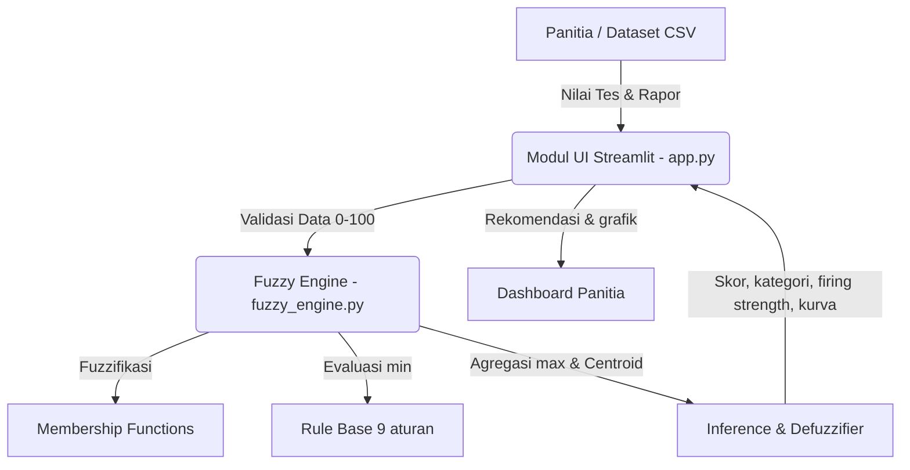

# PROPOSAL PRODUK SISTEM PENDUKUNG KEPUTUSAN FUZZY
## Judul Produk: **SeleksiPintar — Sistem Penentuan Nilai Akhir Seleksi Penerimaan Mahasiswa Baru Berbasis Logika Fuzzy**

### 1. Latar Belakang & Problem Statement

**Masalah nyata.** Panitia penerimaan mahasiswa baru harus menentukan nilai akhir calon mahasiswa dari beberapa komponen, misalnya nilai tes seleksi dan rata-rata nilai rapor. Penilaian pada praktiknya mengandung ketidakpastian: selisih satu poin di sekitar batas kelulusan sering menentukan diterima atau ditolaknya pendaftar, padahal kemampuan kedua pendaftar tersebut hampir sama.

**Mengapa aturan Boolean/kaku kurang optimal.** Dengan aturan tegas (misalnya "diterima jika tes ≥ 70 dan rapor ≥ 75"), pendaftar bernilai tes 69,9 langsung ditolak sedangkan 70,0 diterima. Aturan kaku juga tidak mampu mengompensasi kondisi seperti tes sedikit rendah tetapi rapor sangat tinggi. Himpunan fuzzy memberi transisi bertahap sehingga keputusan lebih adil dan mendekati penalaran panitia yang menggunakan istilah linguistik ("tes cukup baik", "rapor tinggi").

**Pemangku kepentingan.** Panitia seleksi penerimaan mahasiswa baru (pengguna utama), pimpinan program studi (pengambil keputusan akhir), dan calon mahasiswa (pihak yang terdampak keputusan).

**Kebutuhan sistem.**

| Jenis | Kebutuhan |
|---|---|
| Fungsional | Menerima nilai tes dan rapor (input manual/file CSV); memvalidasi rentang 0–100; menghitung derajat keanggotaan, firing strength, dan skor crisp; menampilkan interpretasi teks dan grafik |
| Non-fungsional | Waktu inferensi < 1 detik (hasil uji: ± 0,001 detik per data); antarmuka berupa slider dengan panduan nilai; kode modular (`fuzzy_engine.py` terpisah dari `app.py`) |

### 2. Spesifikasi Variabel Sistem

| Variabel | Peran | Satuan | Semesta | Label Linguistik | Domain (fungsi keanggotaan) |
|---|---|---|---|---|---|
| Nilai Tes Seleksi | Input 1 | Poin | [0, 100] | Rendah, Sedang, Tinggi | Rendah: trapesium (0, 0, 40, 60); Sedang: segitiga (40, 60, 80); Tinggi: trapesium (60, 80, 100, 100) |
| Rata-rata Nilai Rapor | Input 2 | Poin | [0, 100] | Rendah, Sedang, Tinggi | Sama dengan Nilai Tes |
| Skor Akhir Seleksi | Output | Poin | [0, 100] | Rendah, Sedang, Tinggi | Rendah: trapesium (0, 0, 25, 50); Sedang: segitiga (25, 50, 75); Tinggi: trapesium (50, 75, 100, 100) |

Kategori keputusan dari skor crisp: **≥ 70 Layak Diterima**, **50–69,99 Dipertimbangkan**, **< 50 Belum Layak**.

### 3. Rancangan Basis Aturan (Rule Base)

Kombinasi 3 × 3 = 9 aturan (lengkap, tanpa celah):

| Nilai Tes \ Nilai Rapor | Rendah | Sedang | Tinggi |
|---|---|---|---|
| **Rendah** | Rendah | Rendah | Sedang |
| **Sedang** | Rendah | Sedang | Tinggi |
| **Tinggi** | Sedang | Tinggi | Tinggi |

Contoh aturan: `IF Tes = Tinggi AND Rapor = Sedang THEN Skor = Tinggi`. Operator AND memakai **min**.

Dasar penyusunan: nilai tes dan rapor berbobot setara, kondisi salah satu tinggi dan yang lain rendah menghasilkan skor "Sedang" (saling mengompensasi), dan skor "Tinggi" hanya diperoleh jika sedikitnya satu komponen tinggi dan lainnya minimal sedang.

### 4. Metode Inferensi & Defuzzifikasi yang Dipilih

**Pilihan: Mamdani (implikasi Min, agregasi Max) dengan defuzzifikasi Centroid.**

Argumentasi:
1. Keluaran berupa skor kontinu yang harus dapat dijelaskan ke panitia dan calon mahasiswa; Mamdani memiliki himpunan fuzzy keluaran yang intuitif dan mudah divisualisasikan.
2. Centroid mempertimbangkan seluruh luas daerah agregasi sehingga perubahan kecil pada input menghasilkan perubahan skor yang halus (tidak melompat), sesuai tujuan menghindari ketajaman batas aturan kaku.
3. Beban komputasi tetap kecil (9 aturan, resolusi 1001 titik) sehingga memenuhi batas respon < 1 detik.
4. Sugeno/Tsukamoto lebih efisien tetapi keluarannya berupa konstanta/fungsi sehingga kurang sesuai untuk menampilkan kurva agregasi sebagai bukti keputusan.

Catatan: karena fungsi keanggotaan output berbentuk bahu, skor maksimum yang dapat dicapai centroid adalah ± 80,56 dan minimum ± 19,44; ambang kategori (50 dan 70) sudah disesuaikan dengan rentang ini.

### 5. Rencana Arsitektur Perangkat Lunak



**Rencana implementasi UI (Streamlit):**
- Dua slider (Nilai Tes, Nilai Rapor) dengan keterangan rentang 0–100 dan tombol **Hitung**.
- Keluaran: metrik skor akhir + kategori, daftar aturan aktif beserta α, dan grafik agregasi dengan garis centroid.
- Pertemuan 12: pengujian otomatis memakai `data/test_cases.csv` (16 kasus uji). Pertemuan 13: penyempurnaan UI dan unggah CSV massal.

**Struktur proyek:**

```text
Modul-3/
├── Proposal_Produk_<NIM>.md
├── Jawaban_Analisis_Praktikum11.md
├── src/
│   ├── __init__.py
│   ├── fuzzy_engine.py
│   └── app.py
└── data/
    └── test_cases.csv
```
